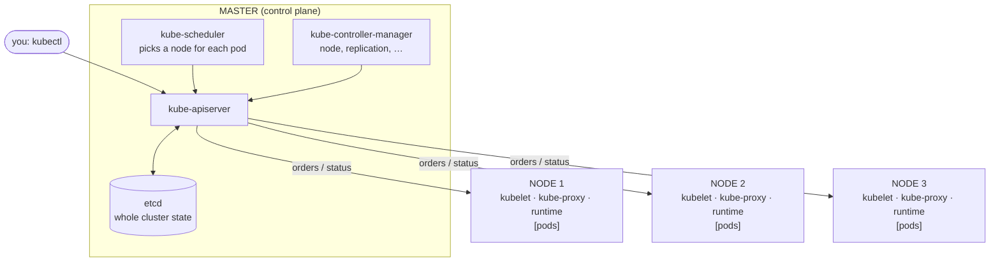

# 00 · Introduction, Architecture & Local Setup

---

## 1. What is Kubernetes?

> "An extensible, open-source platform for managing containerized workloads and services."

- Kubernetes **orchestrates containers**. With 1–2 machines you can manage containers by hand; with 10, 50, 100 machines you need a system that watches everything and **acts automatically**.
- **k8s** = "k" + 8 letters + "s". Name comes from Greek *κυβερνήτης* (helmsman / pilot) — the logo is a ship's wheel: Kubernetes steers the ship that carries your containers.
- **Docker** is used as the container runtime in the explanations below.

What K8s does for you:

| Problem | What Kubernetes does |
|---|---|
| A container dies | Removes it and starts a new one (**self-healing**) |
| A container is using too much CPU | Starts more replicas (**autoscaling**) |
| "Always keep 50 replicas" and 3 die | Recreates the 3 missing ones (**desired state**) |
| Deploying a new version | Rolling updates with no downtime, and **rollbacks** |
| Finding other services | **Service discovery** + internal DNS + load balancing |
| Config & passwords | **ConfigMaps** and **Secrets** |
| Storage | Mounts local or cloud **volumes** |

---

## 2. Architecture

A cluster has two parts: the **Master** (control plane — the "brain") and the **Nodes** (workers — where containers actually run). The master can be replicated for high availability; these notes assume 1 master + N nodes.



### Master components

| Component | Role |
|---|---|
| **kube-apiserver** | The front door. *Everything* talks to the API: you (via `kubectl`), the other master components and the nodes. `kubectl run/get/describe…` = HTTP requests to the API (kubectl converts your command/YAML to JSON). |
| **kube-scheduler** | When you ask for a pod, the API asks the scheduler *"where should this go?"*. It looks at the pod's requirements (CPU, RAM, ports…) and the nodes' free resources and picks the best node. |
| **kube-controller-manager** | Runs the control loops that keep **actual state = desired state**. E.g. *Node controller* (notices when a node goes down), *Replication controller* (keeps the right number of pod replicas), endpoints controller, service account controller… |
| **etcd** | Distributed **key-value database** storing the whole cluster state and config history. It's why K8s knows how to roll back to version 1 after deploying version 2. Back it up! |
| *cloud-controller-manager* | Talks to the cloud provider (load balancers, disks, nodes) on managed clusters like GKE. |

### Node components

| Component | Role |
|---|---|
| **kubelet** | Agent on every node. (1) Receives orders from the master ("run this pod") and makes the runtime do it. (2) Reports node/pod status back to the master. |
| **kube-proxy** | Handles **networking** on each node: makes pods/services reachable, so that replicas of the same app on different nodes can be reached through a single Service (iptables/IPVS rules). |
| **Container runtime** | Actually creates the containers. Must be installed on every node. Docker was the classic choice; others: **containerd**, **CRI-O**. *(Modern clusters, including GKE, use containerd — Docker-built images still work.)* |

### End-to-end flow

`kubectl apply` → **API server** (validates, stores in **etcd**) → **scheduler** chooses a node → **kubelet** on that node gets the pod spec → **runtime** pulls the image and starts the containers → kubelet reports status → **controllers** keep watching and fix any drift.

Knowing which component does what tells you where to look when something breaks.

---

## 3. Local setup with Minikube

**Minikube** = a single-machine local cluster (master and node are the same machine). Enough to learn everything; later sections use a real cloud cluster.

### kubectl

```bash
# macOS
brew install kubectl
kubectl version --client
```

### A driver: Docker or a hypervisor

Minikube needs either a hypervisor (**VirtualBox**, KVM, Hyper-V) or **Docker**. Docker is the simplest option. On macOS install Docker Desktop (or colima).

### Minikube

```bash
brew install minikube
minikube start                     # uses Docker driver if available
minikube start --driver=virtualbox # alternative
minikube status
kubectl cluster-info
kubectl get nodes
```

Windows: disable Hyper-V if using VirtualBox, enable virtualization in BIOS, put `kubectl.exe` and `minikube.exe` in your PATH, then `minikube.exe start --vm-driver="virtualbox"`.

### Basic Minikube commands

```bash
minikube start      # create / start the cluster
minikube stop       # stop it and free resources (keeps state)
minikube delete     # destroy the cluster completely
minikube status
minikube ip         # node IP (useful for NodePort services)
minikube dashboard  # web UI
minikube addons list
```

> If `minikube stop` fails with a lock-file permission error (a known old bug), delete the file it names and retry.
