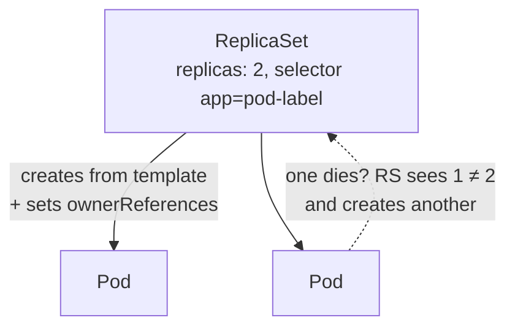

# 02 · ReplicaSets

---

## What is a ReplicaSet?

A **ReplicaSet (RS)** is a higher-level object whose only job is:

> **Keep exactly N pods matching a selector running at all times.**

- You give it a **pod template** and a number of **replicas**.
- If a pod dies → it creates a new one. If there are too many → it deletes some.
- It finds "its" pods **by labels** (the `selector`).
- It marks the pods it owns with an **`ownerReference`** pointing to itself, so another ReplicaSet won't take them.



## Your first ReplicaSet

```bash
kubectl api-resources | grep replicasets
# replicasets  rs  apps/v1  true  ReplicaSet
```

- RS lives in the **`apps`** API group → `apiVersion: apps/v1` (pods have no group → `v1`).
- `kind: ReplicaSet`.

Anatomy of the manifest (`rs.yaml`):

```yaml
apiVersion: apps/v1
kind: ReplicaSet
metadata:              # ← the ReplicaSet's own metadata
  name: rs-test
  labels:
    app: rs-test       # labels OF THE RS (kubectl get rs -l app=rs-test)
spec:                  # ← the ReplicaSet's spec
  replicas: 5
  selector:
    matchLabels:
      app: pod-label   # which pods this RS manages
  template:            # ← everything below is a POD (same as a Pod manifest minus apiVersion/kind)
    metadata:
      labels:
        app: pod-label # MUST match the selector, otherwise the RS can't find what it creates
    spec:
      containers: ...
```

> Key point: the labels in `metadata` belong to the RS; the labels in `template.metadata` belong to the pods. **`template.metadata.labels` must match `spec.selector`.**

```bash
kubectl apply -f rs.yaml
```

> The official docs at kubernetes.io are great reading.

## Verify it works

```bash
kubectl apply -f rs.yaml          # second time: "unchanged" → apply is idempotent
kubectl get pods                  # 5 pods, names = rs-test-<random>
kubectl get pods -l app=pod-label
kubectl get rs                    # DESIRED 5 / CURRENT 5 / READY 5
```

**Self-healing:**
```bash
kubectl delete pod rs-test-xxxxx
kubectl get pods                  # a brand-new pod already replaced it
```

**Scaling:** change `replicas: 5` → `2` and `kubectl apply -f rs.yaml` → RS terminates 3 pods.
(Imperative alternative: `kubectl scale rs rs-test --replicas=2`.)

## Owner references

```bash
kubectl get pod <pod-name> -o yaml
```
```yaml
metadata:
  ownerReferences:
    - apiVersion: apps/v1
      kind: ReplicaSet
      name: rs-test
      uid: 1b2c...07ff57      # ← matches the RS's metadata.uid
      controller: true
```
```bash
kubectl get rs rs-test -o yaml    # metadata.uid is the same UID; RS itself has no ownerReferences (yet)
```

How an RS decides what to do:
1. Look for pods that match the **selector**.
2. Matching pods **without an owner** → it **adopts** them (adds its ownerReference).
3. Not enough pods → it **creates** them from the template (and owns them).

## Pod adoption — why you should avoid bare pods

Experiment:
```bash
kubectl delete -f rs.yaml                         # deleting the RS deletes its pods too
kubectl run podtest1 --image=nginx:alpine         # bare pods, NOT python like the RS template
kubectl run podtest2 --image=nginx:alpine
kubectl label pod podtest1 app=pod-label          # give them the RS's selector label
kubectl label pod podtest2 app=pod-label
kubectl apply -f rs.yaml                          # replicas: 3
kubectl get pods                                  # only ONE new pod is created!
kubectl get pod podtest1 -o yaml                  # now has ownerReferences → rs-test
```

The RS **adopted** the two orphan nginx pods because their labels matched — even though they're totally different from its template. You end up with inconsistent pods (2 × nginx + 1 × python).
If you delete one of the adopted pods, the replacement is created from the template (python).

> **Lesson:** don't create bare pods, and don't put labels on them that collide with your apps. Let higher-level objects create pods.

## The problem with ReplicaSets

An RS only compares **number of pods with matching labels** vs **replicas**. It **does not compare the pod template**.

Experiment: change the template (e.g. `python:3.6-alpine` → `python:3.7-alpine`, remove a container) and `kubectl apply`:

```bash
kubectl get rs rs-test -o yaml           # the RS object IS updated (new template)
kubectl get pods                         # but the existing pods are untouched
kubectl describe pod <pod> | grep Image  # still python:3.6
```

Only pods created **after** the change use the new template. To "update" you'd have to manually delete every pod so the RS recreates them — unworkable with 1000 pods and causes downtime.

Solution: an even higher-level object that **owns ReplicaSets** and handles updates → **Deployment** ([next](../03-deployments/README.md)).

Hierarchy so far: **Deployment → ReplicaSet → Pods**.

---

## Cheat sheet

```bash
kubectl apply -f rs.yaml
kubectl get rs [-o yaml] [-l key=value]
kubectl describe rs <name>
kubectl scale rs <name> --replicas=N
kubectl get pod <pod> -o yaml          # look at metadata.ownerReferences
kubectl delete -f rs.yaml              # deletes RS and the pods it owns
```
