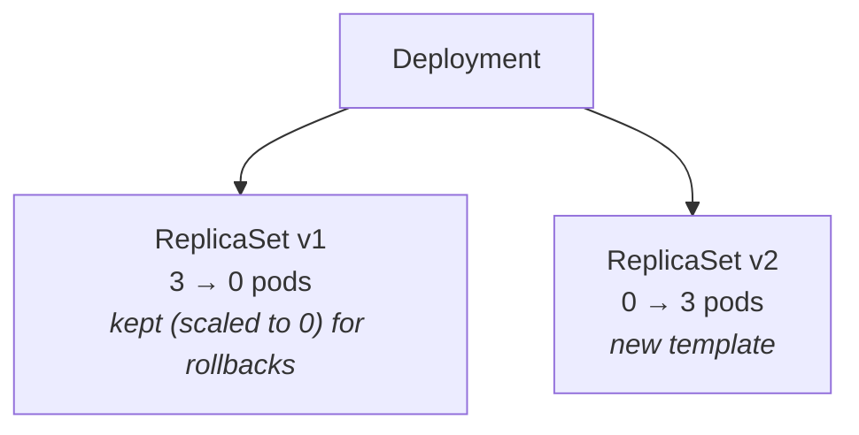

# 03 · Deployments

---

## What is a Deployment?

A **Deployment** owns ReplicaSets, which own Pods. You only tell the Deployment *what you want* (e.g. "use image v2"); it handles *how* to get there without downtime.



### Rolling update — what happens when you change the pod template

1. The Deployment creates a **new ReplicaSet** with the new template.
2. It gradually **scales up the new RS** and **scales down the old RS**, respecting two parameters:

| Parameter | Meaning | Default |
|---|---|---|
| **`maxUnavailable`** | How many pods (below the desired count) may be unavailable during the update | **25 %** → at least 75 % always running |
| **`maxSurge`** | How many extra pods (above the desired count) may be created during the update | **25 %** → up to 125 % of pods |

With 3 replicas: create 1 new (4 total, the surge limit) → kill 1 old → create 1 new → kill 1 old → … until new RS = 3, old RS = 0.
The app is **never down** — there are always pods serving.

3. Old ReplicaSets stay at **0 replicas** so you can **roll back** to them.

```yaml
# optional, inside the Deployment's spec
strategy:
  type: RollingUpdate
  rollingUpdate:
    maxUnavailable: 25%
    maxSurge: 25%
```

## Your first Deployment

```bash
kubectl api-resources | grep deployments
# deployments  deploy  apps/v1  true  Deployment
```

The manifest looks almost identical to a ReplicaSet — just `kind: Deployment`. See `dep.yaml`.

- `containerPort` is mostly informational metadata (it'll matter later with **Services**).

```bash
kubectl apply -f dep.yaml
kubectl get deployment                  # or: kubectl get deploy
kubectl get deploy --show-labels
kubectl rollout status deployment deployment-test   # "successfully rolled out"
```

## Owner references: Deployment → RS → Pods

```bash
kubectl get rs --show-labels            # deployment-test-<hash>
kubectl get pods --show-labels          # deployment-test-<hash>-<random>
```

- The RS and pods get an automatic **`pod-template-hash`** label (same value as the RS name suffix). Kubernetes uses it to tell the pods of different ReplicaSets apart.
- `kubectl get deploy deployment-test -o yaml` → no `ownerReferences` (top of the hierarchy).
- `kubectl get rs deployment-test-<hash> -o yaml` → `ownerReferences: kind: Deployment, name: deployment-test, uid: …` (matches the Deployment's `uid`).
- `kubectl get pod <pod> -o yaml` → owner is the **ReplicaSet**, not the Deployment.

## Rolling updates

Change the image (e.g. `nginx:alpine` → `nginx`) and apply:

```bash
kubectl apply -f dep.yaml
kubectl get pods                                     # watch new pods appear while old ones terminate
kubectl rollout status deployment deployment-test   # live progress: "1 of 3 updated replicas are available…"
kubectl describe deployment deployment-test         # Events: Scaled up RS-new to 1, Scaled down RS-old to 2, …
```

> Note: the container `name` is arbitrary, but `image` must be a real image name (it's what gets pulled, like `docker pull nginx`).

Imperative alternative: `kubectl set image deployment/deployment-test nginx=nginx:1.27`.

## History & revisions

Every rollout = a new ReplicaSet = a new **revision**.

```bash
kubectl get rs -l app=front
kubectl rollout history deployment deployment-test
# REVISION  CHANGE-CAUSE
# 1         <none>
# 2         <none>
```

Any change in the **pod template** (image, `containerPort`, env, …) triggers a new rollout.

How many old ReplicaSets are kept: **`revisionHistoryLimit`** (default **10**).

```yaml
spec:
  revisionHistoryLimit: 1     # keep only 1 old ReplicaSet
```

> **Warning:** `kubectl delete -f dep.yaml` deletes the Deployment **and** all its ReplicaSets and pods — careful in production.

## CHANGE-CAUSE — document why you changed things

`CHANGE-CAUSE` is `<none>` unless you set it. Three ways:

1. **`--record` flag** – `kubectl apply -f dep.yaml --record` stores the command you ran.
   > **Warning:** `--record` is **deprecated**; prefer option 2.
2. **Annotation in the manifest (recommended)** – under the Deployment's `metadata`:
   ```yaml
   metadata:
     annotations:
       kubernetes.io/change-cause: "Changed port to 110"
   ```
   Like a commit message for the rollout. Remember to update it on every change.
3. **`kubectl annotate`** –
   `kubectl annotate deployment deployment-test kubernetes.io/change-cause="Changed port to 110"`

Inspect what a revision contained:
```bash
kubectl rollout history deployment deployment-test --revision=3
```

## Rollback

Why roll back: the new version deploys fine but the **app is buggy**, or the rollout gets **stuck/unstable** (bad config, network, nonexistent image…).

Simulate a bad release — set `image: nginx:fake` and apply:
```bash
kubectl apply -f dep.yaml
kubectl get pods                       # new pod: ErrImagePull / ImagePullBackOff
                                       # old pods keep running thanks to maxUnavailable
kubectl rollout history deployment deployment-test
```

Go back to a known-good revision:
```bash
kubectl rollout undo deployment deployment-test --to-revision=3
kubectl rollout status deployment deployment-test
kubectl describe deployment deployment-test   # image is back to nginx:alpine
```

(`kubectl rollout undo deployment deployment-test` with no flag = go back to the previous revision.)

With the default `revisionHistoryLimit: 10`, you can go back up to 10 revisions.

---

## Cheat sheet

```bash
kubectl apply -f dep.yaml
kubectl get deploy [--show-labels] [-o yaml]
kubectl describe deploy <name>                       # Events show each scale up/down step
kubectl rollout status  deployment <name>
kubectl rollout history deployment <name> [--revision=N]
kubectl rollout undo    deployment <name> [--to-revision=N]
kubectl annotate deployment <name> kubernetes.io/change-cause="msg"
kubectl set image deployment/<name> <container>=<image>
kubectl scale deployment <name> --replicas=N
kubectl delete -f dep.yaml                           # removes deploy + RSs + pods
```

## Summary: Pod vs ReplicaSet vs Deployment

| | Pod | ReplicaSet | Deployment |
|---|---|---|---|
| apiVersion | `v1` | `apps/v1` | `apps/v1` |
| Self-healing | no | yes | yes |
| Scaling / N replicas | no | yes | yes |
| Updates pods on template change | no (immutable) | no | yes (rolling update) |
| History / rollback | no | no | yes |
| Use it directly? | Only for learning | Rarely | **Yes — default choice** |
