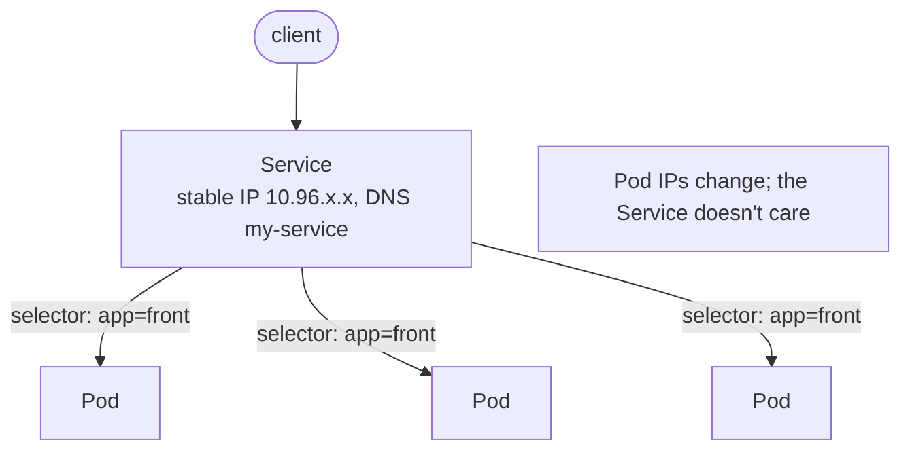
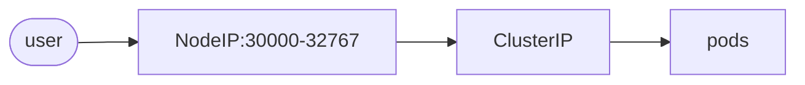
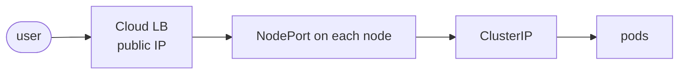

# 04 · Services & Endpoints

---

## Why Services?

A Deployment gives you N identical pods (more pods = high availability + more load: if 2 pods handle 100 req/s, 4 handle ~200 req/s). But:

- each pod has its **own IP**,
- pods die and come back with a **new IP**,
- clients need **one stable entry point**.

A **Service** is that stable entry point: a **fixed virtual IP + DNS name** that **load-balances** across all pods matching a **label selector**.



## Endpoints

When you create a Service with a selector, Kubernetes automatically creates an **Endpoints** object with the **same name**: the list of `IP:port` of the pods currently matching the selector.

- Pod dies → its IP is removed. New pod → its IP is added.
- The Service uses this list to know where to send traffic.

*(Newer clusters also create **EndpointSlices** — same idea, more scalable: `kubectl get endpointslices`.)*

## Your first Service

See `svc.yaml` — a Deployment + a Service in the same file (separated by `---`, created in order).

```yaml
apiVersion: v1            # Services are in the core group → no "apps/"
kind: Service
metadata:
  name: my-service
  labels:
    app: front            # labels OF the service (for filtering)
spec:
  type: ClusterIP         # default if omitted
  selector:
    app: front            # which PODS receive traffic
  ports:
    - protocol: TCP
      port: 8080          # port the Service listens on
      targetPort: 80      # port of the container (nginx listens on 80)
```

```bash
kubectl apply -f svc.yaml
```

## Describe your Service

```bash
kubectl get svc                  # svc = shortname (see kubectl api-resources)
kubectl get svc -l app=front
kubectl describe svc my-service
```

Fields: **TYPE** (ClusterIP by default), **CLUSTER-IP** (virtual IP — not tied to any physical NIC), **EXTERNAL-IP**, **PORT(S)**, and in `describe`: **Selector**, **Endpoints**.

The `kubernetes` service in `default` always exists — it's the API server itself.

## Pods & Endpoints

```bash
kubectl get endpoints my-service       # or: kubectl get ep
kubectl get pods -l app=front -o wide  # -o wide shows pod IPs → same IPs as the endpoints
kubectl delete pod <one-pod>           # RS recreates it with a new IP
kubectl get ep my-service              # old IP gone, new IP present — updated automatically
```

## Services and DNS

Every Service gets a **DNS name**. From inside the cluster:

```bash
kubectl run --rm -it podtest3 --image=nginx:alpine -- sh   # temporary pod, deleted on exit
apk add -q curl
curl <cluster-ip>          # nothing! the service listens on 8080, not 80
curl <cluster-ip>:8080     # works: proxied to a pod on port 80
curl my-service:8080       # works: by DNS name — this is what apps should use
```

Full name: `<service>.<namespace>.svc.cluster.local` (more in [06-namespaces](../06-namespaces/README.md)).

> Apps should talk to each other by **service name**, never by pod IP.

## Service types

### ClusterIP — default, internal only

- A virtual IP reachable **only inside the cluster**.
- In Minikube you could open it from your laptop's browser only because your laptop *is* the cluster; from another machine's IP it doesn't work.
- Use it for **internal service-to-service** communication (e.g. backend APIs, databases).

### NodePort — expose on every node's IP



- Opens the same port (default range **30000–32767**) on **every node**.
- A NodePort Service **also creates a ClusterIP** automatically.
- See `nodeport.yaml`.

```bash
kubectl apply -f nodeport.yaml
kubectl get svc my-service1      # PORT(S) 8080:3XXXX/TCP
minikube ip                      # node IP
curl $(minikube ip):3XXXX
minikube service my-service1 --url   # easiest way on macOS/Docker driver
```

You can fix the port with `nodePort: 30080` under `ports` (must be in range and free).

### LoadBalancer — a real cloud load balancer



- Asks the **cloud provider** to provision an external load balancer automatically. Creating it automatically creates a **NodePort** and a **ClusterIP** too (same hierarchy idea as Deployment → RS → Pods).
- Doesn't work on plain Minikube (no cloud). Workaround: `minikube tunnel`.
- On **GKE** this gives you a Google Cloud external passthrough Network Load Balancer with a public IP — see [17-gke-cluster](../17-gke-cluster/README.md).

| Type | Reachable from | Creates |
|---|---|---|
| `ClusterIP` | inside cluster only | virtual IP + DNS |
| `NodePort` | `<any-node-ip>:<nodePort>` | ClusterIP + node port |
| `LoadBalancer` | public IP of cloud LB | ClusterIP + NodePort + cloud LB |
| *(ExternalName)* | — | DNS CNAME to an external name |

---

## Cheat sheet

```bash
kubectl get svc [-l key=val] [-o wide]
kubectl describe svc <name>
kubectl get ep <name>                         # endpoints
kubectl expose deployment <dep> --port=8080 --target-port=80 [--type=NodePort]
kubectl port-forward svc/<name> 9090:8080     # reach a ClusterIP from your laptop
kubectl run --rm -it tmp --image=nginx:alpine -- sh   # throwaway debug pod
minikube service <name> --url
minikube tunnel                               # makes LoadBalancer services work locally
```
