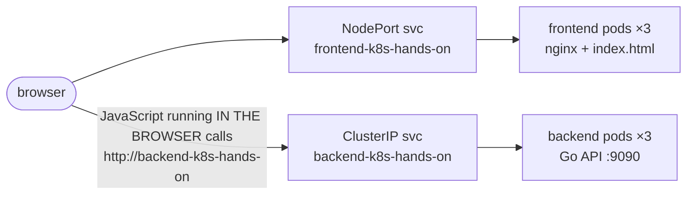

# 05 · Hands-on: Go backend + JavaScript frontend

Putting Deployments + Services together in a real two-tier app.

---

## Architecture



- **Backend**: Go REST API returning `{"time": ..., "hostname": ...}` → Deployment + **ClusterIP** Service (internal).
- **Frontend**: static `index.html` served by nginx, with JS that calls the backend → Deployment + **NodePort** Service (reachable from outside).
- The `hostname` in each response is the **pod name**, so refreshing shows the Service load-balancing between pods.

## Backend

`backend/src/main.go` — standard library only (no deps → trivial to containerize):
- `GET /` → JSON with `time.Now()` and `os.Getenv("HOSTNAME")` (K8s sets HOSTNAME = pod name).
- Listens on **:9090**.

Run it locally without K8s:
```bash
cd backend/src && go run main.go          # or with Docker:
docker run --rm -p 9090:9090 -v $PWD:/app -w /app golang:1.13 go run main.go
curl localhost:9090
```

`backend/Dockerfile` — **multi-stage build**:
1. `golang:1.13` stage compiles a static binary (`CGO_ENABLED=0 GOOS=linux go build -o app`).
2. `alpine` stage copies only the binary → tiny image.

```bash
cd backend
docker build -t k8s-hands-on:v1 .
```


## Backend manifests

`backend/backend.yaml`: Deployment (3 replicas, label `app: backend`) + Service:

```yaml
ports:
  - protocol: TCP
    port: 80          # service port
    targetPort: 9090  # Go app port
```

- No `type` → **ClusterIP**.
- `imagePullPolicy: IfNotPresent` → use the local image if it exists (needed for images you built locally into Minikube's Docker: run `eval $(minikube docker-env)` before `docker build`, or `minikube image load k8s-hands-on:v1`).

Test from inside the cluster:
```bash
kubectl apply -f backend/backend.yaml
kubectl run --rm -it tmp --image=nginx:alpine -- sh
apk add -q curl
curl <cluster-ip>                 # port 80 by default
curl backend-k8s-hands-on         # DNS works too
# run it several times → "hostname" changes = load balancing across pods
```

From your laptop (cluster not local): `kubectl port-forward service/backend-k8s-hands-on 9090:80`.

## Frontend

`frontend/src/index.html`: JS `XMLHttpRequest` → `GET http://backend-k8s-hands-on`, then renders *"La hora es … y el hostname es …"* plus an image.

**Key gotcha:** this JS runs **in the user's browser**, *outside* the cluster. The browser can't resolve the internal DNS name `backend-k8s-hands-on` or reach a ClusterIP. Workaround:

```bash
kubectl port-forward service/backend-k8s-hands-on 80:80     # keep running
sudo sh -c 'echo "127.0.0.1 backend-k8s-hands-on" >> /etc/hosts'
```

(In production you'd expose the backend through an **Ingress** — see [16-ingress](../16-ingress/README.md) — and call it by a public hostname or same-origin path.)

### CORS fix → backend v2

The browser blocked the call: *No 'Access-Control-Allow-Origin' header*. Fix in Go:
```go
w.Header().Set("Access-Control-Allow-Origin", "*")
```
Rebuild as a **new tag** and roll out:
```bash
docker build -t k8s-hands-on:v2 .
# edit backend.yaml → image: k8s-hands-on:v2
kubectl apply -f backend/backend.yaml       # rolling update!
```

## Frontend manifests & image

`frontend/Dockerfile`:
```dockerfile
FROM nginx:alpine
COPY ./src/index.html /usr/share/nginx/html/index.html
```
```bash
cd frontend && docker build -t frontend-k8s-hands-on:v1 .
```

`frontend/frontend.yaml`: same shape as the backend, but `type: NodePort`, `port: 80`.
If `port` == container port you can omit `targetPort` (it defaults to `port`).

```bash
kubectl apply -f frontend/frontend.yaml
kubectl get pods -l app=frontend
kubectl get svc                              # frontend: 80:3XXXX/TCP
minikube service frontend-k8s-hands-on --url
```

From another machine on your network: `http://<your-machine-ip>:<nodePort>` (the random port in 30000–32767, **not** 80).

---

## What this section reinforces

- Deployment = how many copies + which image; Service = how to reach them.
- **ClusterIP** for internal APIs, **NodePort/LoadBalancer/Ingress** for things users hit.
- Services give **DNS names** — apps call each other by name.
- A new image tag + `kubectl apply` = **rolling update**.
- Code running in the browser is *outside* the cluster.
