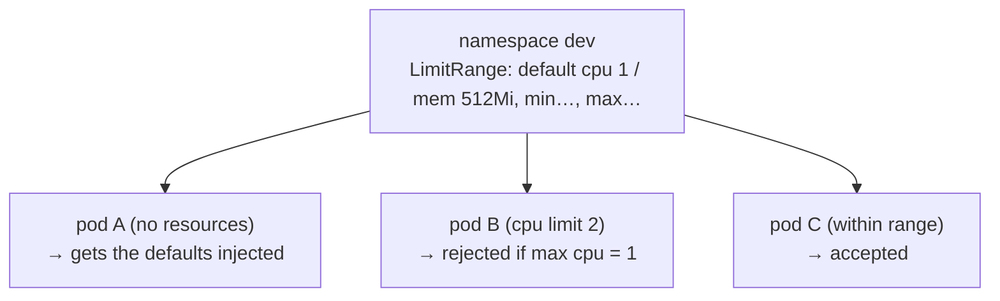

# 08 · LimitRange — per-object resource policies

---

## What is a LimitRange?

A **LimitRange** is a namespaced object that applies resource policies **to each individual object** (container / pod / PVC) created in **its namespace**:

1. **Defaults** – inject `requests`/`limits` into containers that don't define them.
2. **Min / Max** – reject containers whose requests/limits are outside the allowed range (the object isn't even created).
3. *(also: `maxLimitRequestRatio`, and min/max storage for PVCs)*



> It's checked by an **admission controller** at creation time — existing pods aren't changed.
> A LimitRange only affects the namespace it lives in.

## Defaults

Creates namespace `dev`, a LimitRange, and a pod **without** resources:

```yaml
apiVersion: v1
kind: LimitRange
metadata:
  name: mem-cpu-limit-range
  namespace: dev
spec:
  limits:
  - type: Container
    default:            # → limits
      memory: 512Mi
      cpu: 1
    defaultRequest:     # → requests
      memory: 256Mi
      cpu: 0.5
```

```bash
kubectl apply -f default-cpu-mem.yaml
kubectl get limitrange -n dev            # or: kubectl get limits -n dev
kubectl describe limitrange mem-cpu-limit-range -n dev
kubectl get pod podtest3 -n dev -o yaml | grep -A8 resources   # defaults were injected
kubectl describe pod podtest3 -n dev     # also shows an annotation saying LimitRanger set them
```

## Min / Max

```yaml
spec:
  limits:
  - type: Container
    max:
      memory: 1Gi
      cpu: 1
    min:
      memory: 100M
      cpu: 100m
```

```bash
kubectl apply -f min-max-limits.yaml
# pod asks for limits memory: 50M, cpu: 50m → below min:
# Error from server (Forbidden): pods "podtest3" is forbidden: [minimum cpu usage per Container is 100m, but limit is 50m, …]
```

- Change the pod to `limits: {memory: 500M, cpu: 0.5}` / `requests: {memory: 400M, cpu: 0.3}` → accepted.
- Ask for `cpu: 2` → forbidden (above max).

> YAML gotcha: `resources:` must be **inside each container** item, at the same level as `name`/`image`.

> With a Deployment, a rejected pod doesn't make `apply` fail — the **ReplicaSet** fails to create pods. Look at `kubectl describe rs <name>` events.

## LimitRange vs ResourceQuota

| | LimitRange | ResourceQuota ([next](../09-resourcequota/README.md)) |
|---|---|---|
| Scope | **each object** in the namespace | **sum of all objects** in the namespace |
| Example | "no container may use > 1 CPU" | "the whole namespace may use ≤ 3 CPU" |
| Defaults | yes, can inject defaults | no |

---

## Cheat sheet

```bash
kubectl get limits -n <ns>
kubectl describe limits <name> -n <ns>
kubectl describe ns <ns>          # shows LimitRange + ResourceQuota summary
```
