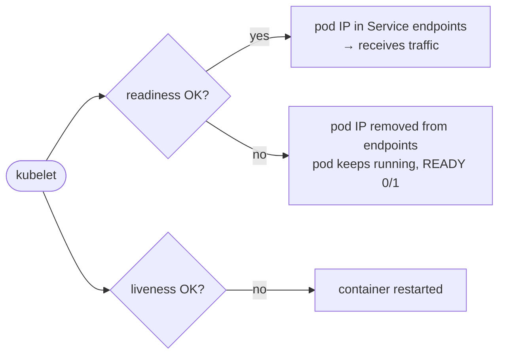

# 10 · Health Checks & Probes

---

## What is a probe?

A **probe** is a periodic **diagnostic** that the **kubelet** (the agent on each node) runs against a **container** to know whether it's healthy. You define *what* to check and *how often*; the kubelet acts on the result.

### Three ways to probe

| Handler | Success when… | Use for |
|---|---|---|
| `exec` | the command inside the container exits **0** | apps without HTTP, custom checks |
| `tcpSocket` | a TCP connection to the port **opens** | DBs, raw TCP services |
| `httpGet` | HTTP response code **200–399** | web apps / APIs (`/healthz`) |
| *(`grpc`)* | gRPC health check returns SERVING | gRPC services |

### Timing fields

| Field | Meaning | Default |
|---|---|---|
| `initialDelaySeconds` | wait after container start before the 1st probe | 0 |
| `periodSeconds` | how often | 10 |
| `timeoutSeconds` | probe timeout | 1 |
| `failureThreshold` | consecutive failures before acting | 3 |
| `successThreshold` | consecutive successes to be OK again | 1 |

## Types of probes

| Probe | Question | On failure |
|---|---|---|
| **livenessProbe** | "Is the app still **alive**?" (e.g. after hours it hangs or only returns 500s, but the process is still running) | kubelet **restarts the container** |
| **readinessProbe** | "Is it **ready to receive traffic**?" | pod IP is **removed from the Service's Endpoints** (no restart). Added back when it passes again |
| **startupProbe** | "Has a **slow-starting** app finished booting?" | liveness/readiness are disabled until it passes; if it never passes → restart |

They're independent: use one, two or all three, each with any handler. It's common for readiness and liveness to look alike.

## Liveness with a command — [`liveness-cmd.yaml`](liveness-cmd.yaml)

The container creates `/tmp/healthy`, deletes it after 30 s, then sleeps:
```yaml
args: ["/bin/sh", "-c", "touch /tmp/healthy; sleep 30; rm -rf /tmp/healthy; sleep 600"]
livenessProbe:
  exec:
    command: ["cat", "/tmp/healthy"]
  initialDelaySeconds: 5
  periodSeconds: 5
```
```bash
kubectl apply -f liveness-cmd.yaml
kubectl describe pod liveness-exec   # after ~35s: Liveness probe failed: cat: can't open '/tmp/healthy'
kubectl get pod liveness-exec -w     # RESTARTS increases every cycle
```

## Liveness with TCP — [`liveness-tcp.yaml`](liveness-tcp.yaml)

```yaml
livenessProbe:
  tcpSocket:
    port: 8080
  initialDelaySeconds: 15     # first check after 15s
  periodSeconds: 20           # then every 20s
```
If the port stops accepting connections → container restarted.

## Liveness with HTTP — [`liveness-http.yaml`](liveness-http.yaml)

```yaml
livenessProbe:
  httpGet:
    path: /healthz
    port: 8080
    httpHeaders:
    - name: Custom-Header
      value: Awesome
  initialDelaySeconds: 3
  periodSeconds: 3
```
The `registry.k8s.io/liveness` test image returns 200 on `/healthz` for 10 s, then 500 → you'll see restarts.
`initialDelaySeconds` and `periodSeconds` don't have to match — tune them to how long *your* app takes to start.

## Readiness

Already in [`liveness-tcp.yaml`](liveness-tcp.yaml):
```yaml
readinessProbe:
  tcpSocket:
    port: 8080
  initialDelaySeconds: 5
  periodSeconds: 10
```



```bash
kubectl get pods                 # READY 0/1 while readiness fails
kubectl get endpoints <svc>      # the not-ready pod's IP is missing
```

> **Readiness** = stop sending traffic. **Liveness** = restart it. Getting this right is what makes rolling updates truly zero-downtime: the Deployment waits for new pods to be *Ready* before killing old ones.

---

## Template

```yaml
containers:
- name: app
  image: my-app:1.0
  ports: [{containerPort: 8080}]
  startupProbe:
    httpGet: {path: /healthz, port: 8080}
    failureThreshold: 30
    periodSeconds: 10          # up to 300s to start
  readinessProbe:
    httpGet: {path: /ready, port: 8080}
    periodSeconds: 5
  livenessProbe:
    httpGet: {path: /healthz, port: 8080}
    periodSeconds: 10
    failureThreshold: 3
```
