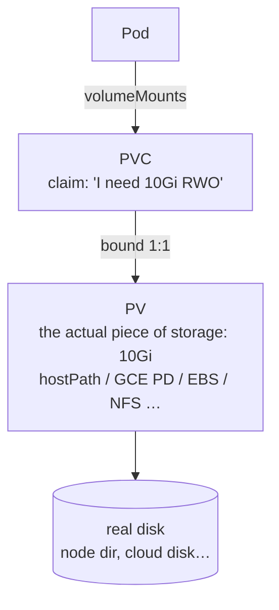

# 13 · Volumes: emptyDir, hostPath, PV, PVC, StorageClass

---

## Part 1 — Concepts

### What is a volume?

So far everything has been **stateless**: pods can die and be recreated freely because they store nothing. But a container's filesystem is **ephemeral** — when the container dies, its files die too.

A **volume** abstracts storage away from the container so data can outlive it (and, depending on the type, outlive the pod).

Every volume has two parts in the pod spec:
```yaml
spec:
  containers:
  - name: app
    volumeMounts:          # WHERE inside the container
    - name: data
      mountPath: /var/lib/data
  volumes:                 # WHAT the source is
  - name: data
    <type>: {...}          # emptyDir / hostPath / configMap / secret / persistentVolumeClaim / …
```

### emptyDir

- An empty directory created **at pod level** when the pod starts.
- Survives **container** restarts (kubelet recreates the container, data is still there).
- Is **deleted when the pod is deleted**. Lifetime = pod lifetime.
- Shared by all containers in the pod → great for **cache**, scratch space, sharing files between sidecars.

### hostPath

- Mounts a directory **from the node's filesystem** (like `docker run -v /mnt:/opt`).
- Survives pod deletion — lifetime = **node** lifetime.
- **Problem:** if the pod is rescheduled onto **another node**, it sees that node's (empty) directory → data "lost". Also a security risk. OK for single-node labs (Minikube) or node agents; avoid for apps.

### Cloud volumes

- Cloud block disks: **AWS EBS**, **Google Persistent Disk (PD)**, Azure Disk.
- Data lives independently of pods *and* nodes — the disk follows the pod to any node.
- Problem if used directly in a pod: the pod author must know cloud details (**disk ID**, **filesystem type** ext4/xfs, zone…). A developer just wants "10 GB of persistent storage".

### PV and PVC

Kubernetes separates **who provides** storage from **who consumes** it:



- **PersistentVolume (PV)** – cluster-level object (not namespaced) representing real storage. Created by an **admin** (static) or by a **StorageClass** (dynamic).
- **PersistentVolumeClaim (PVC)** – namespaced **request** for storage by a user: size + access mode (+ optional class/selector).
- Kubernetes **binds** a PVC to a matching PV (one-to-one, exclusive).
- The pod only references the **PVC** — no cloud details.

**Access modes**

| Mode | Meaning |
|---|---|
| `ReadWriteOnce` (RWO) | read-write by **one node** at a time (block disks: GCE PD, EBS) |
| `ReadOnlyMany` (ROX) | read-only by many nodes |
| `ReadWriteMany` (RWX) | read-write by many nodes (NFS, Filestore, EFS) |
| `ReadWriteOncePod` | read-write by a single pod |

### Reclaim policy

What happens to the **PV** (and its data) when its **PVC is deleted**?

| Policy | What happens | Default for |
|---|---|---|
| **Retain** | PV + data kept, PV goes `Released` and is **not** reusable by new claims. Admin decides what to do (backup, delete manually) | manually created PVs |
| **Recycle** | data wiped (`rm -rf`), PV becomes `Available` again. **Deprecated** — use dynamic provisioning instead | — |
| **Delete** | PV **and the underlying disk** are deleted | dynamically provisioned PVs (StorageClass) |

---

## Part 2 — Practice

### emptyDir for cache

```yaml
volumeMounts:
- mountPath: /var/log/nginx
  name: vol
volumes:
- name: vol
  emptyDir: {}
```
```bash
kubectl apply -f empty-dir.yaml
kubectl exec -it test-pd -- sh -c 'echo hola > /var/log/nginx/test.txt'
kubectl exec -it test-pd -- sh -c 'kill 1'          # kill nginx → container restarts, pod stays
kubectl exec -it test-pd -- cat /var/log/nginx/test.txt   # still there
kubectl delete pod test-pd && kubectl apply -f empty-dir.yaml
kubectl exec -it test-pd -- ls /var/log/nginx       # gone (new pod = new emptyDir)
```
Options: `emptyDir: {medium: Memory, sizeLimit: 128Mi}` (RAM-backed tmpfs).

### Static provisioning: create PV + PVC by hand

```yaml
apiVersion: v1
kind: PersistentVolume
metadata:
  name: task-pv-volume
  labels: {type: local}
spec:
  storageClassName: manual
  capacity:
    storage: 10Gi
  accessModes: [ReadWriteOnce]
  hostPath:
    path: "/test"                 # directory on the (Minikube) node
---
apiVersion: v1
kind: PersistentVolumeClaim
metadata:
  name: task-pv-claim
spec:
  storageClassName: manual
  accessModes: [ReadWriteOnce]
  resources:
    requests:
      storage: 10Gi
```
```bash
kubectl apply -f pv-pvc.yaml
kubectl get pv      # STATUS: Bound, CLAIM: default/task-pv-claim
kubectl get pvc     # STATUS: Bound, VOLUME: task-pv-volume
```
Without a selector, K8s binds the PVC to **any** PV with the same `storageClassName`, a compatible access mode and enough capacity. Since binding is exclusive, a 3Gi claim would still take the whole 10Gi PV — so the example requests all 10Gi.

PV status lifecycle: `Available` → `Bound` → (PVC deleted) `Released` → (`Failed`).

### PVC with a selector

Two matching PVs exist; choose one by **label**:
```yaml
# PV
metadata:
  name: task-pv-volume2
  labels:
    mysql: ready
---
# PVC
spec:
  ...
  selector:               # same level as resources
    matchLabels:
      mysql: ready
```
```bash
kubectl apply -f selector.yaml
kubectl get pvc     # bound to task-pv-volume2
```

### Why PV/PVC matter: MySQL without persistence

Deploy MySQL with no volume, create a database, delete the pod → the new pod has **no data**. Stateful apps need a PVC.

### Mount a PVC in a pod

PV (`hostPath: /mysql`, label `mysql: ready`) + PVC (selector) + MySQL Deployment:
```yaml
containers:
- name: mysql
  image: mysql:5.7
  env:
  - name: MYSQL_ROOT_PASSWORD
    value: "12345678"           # ← use a Secret in real life!
  volumeMounts:
  - mountPath: "/var/lib/mysql" # where MySQL stores its data
    name: vol-mysql
volumes:
- name: vol-mysql
  persistentVolumeClaim:
    claimName: test-pvc
```
```bash
kubectl apply -f pod-pvc.yaml
kubectl exec -it <mysql-pod> -- mysql -uroot -p12345678 -e "CREATE DATABASE test;"
kubectl delete pod <mysql-pod>            # Deployment recreates it
kubectl exec -it <new-pod> -- mysql -uroot -p12345678 -e "SHOW DATABASES;"   # test is still there
minikube ssh -- ls /mysql                 # the data lives on the node
```

> For databases in production prefer a **StatefulSet** with `volumeClaimTemplates` (stable identity + one PVC per replica).

### StorageClass & dynamic provisioning

**Static**: admin pre-creates PVs. **Dynamic**: a **StorageClass** creates a PV **automatically** when a PVC needs one.

```bash
kubectl get storageclass     # or: kubectl get sc
# Minikube: "standard (default)"  provisioner: k8s.io/minikube-hostpath
# GKE:      "standard-rwo (default)" provisioner: pd.csi.storage.gke.io  (balanced PD)
#           "premium-rwo" (SSD), "standard" (HDD)
```
```yaml
apiVersion: v1
kind: PersistentVolumeClaim
metadata:
  name: sc-pvc
spec:
  # storageClassName: standard   ← omit to use the default class
  accessModes: [ReadWriteOnce]
  resources:
    requests:
      storage: 20Gi
```
```bash
kubectl apply -f storage-class.yaml
kubectl get pvc,pv          # a pvc-<uid> PV appeared automatically, RECLAIM POLICY: Delete
```
On GKE this actually creates a 20 GB Google Persistent Disk. A custom class:
```yaml
apiVersion: storage.k8s.io/v1
kind: StorageClass
metadata:
  name: fast-ssd
provisioner: pd.csi.storage.gke.io
parameters:
  type: pd-ssd
reclaimPolicy: Retain
volumeBindingMode: WaitForFirstConsumer
allowVolumeExpansion: true
```

### Reclaim policy: Retain

```bash
kubectl delete deploy mysql        # PV & PVC still there — separate objects
kubectl delete pvc test-pvc
kubectl get pv                     # STATUS: Released (not Available) — data kept
minikube ssh -- ls /mysql          # still there
kubectl delete pv test-pv          # admin cleans up when ready
```

### Reclaim policy: Recycle

Change the policy on an existing PV with `kubectl edit`:
```bash
kubectl edit pv test-pv            # persistentVolumeReclaimPolicy: Recycle
# or: kubectl patch pv test-pv -p '{"spec":{"persistentVolumeReclaimPolicy":"Recycle"}}'
kubectl delete deploy mysql && kubectl delete pvc test-pvc
kubectl get pv                     # goes back to Available; contents wiped
```
`kubectl edit` works on any object (deployments, services, …) and applies on save.
> **Warning:** Recycle is deprecated and only supported by NFS/hostPath.

### Reclaim policy: Delete

```bash
kubectl edit pv test-pv            # persistentVolumeReclaimPolicy: Delete
kubectl delete deploy mysql && kubectl delete pvc test-pvc
kubectl get pv                     # PV deleted (with a cloud disk, the disk is deleted too!)
```
On Minikube the hostPath deleter refuses to delete folders outside `/tmp` → PV shows `Failed` (`kubectl describe pv` explains). In the cloud it works and **the disk is gone** — use `Retain` for important data.

---

## Cheat sheet

```bash
kubectl get pv,pvc,sc
kubectl describe pv <pv> | kubectl describe pvc <pvc>
kubectl edit pv <pv>                     # change reclaim policy, etc.
kubectl patch pv <pv> -p '{"spec":{"persistentVolumeReclaimPolicy":"Retain"}}'
minikube ssh                             # look at hostPath dirs on the node
```
