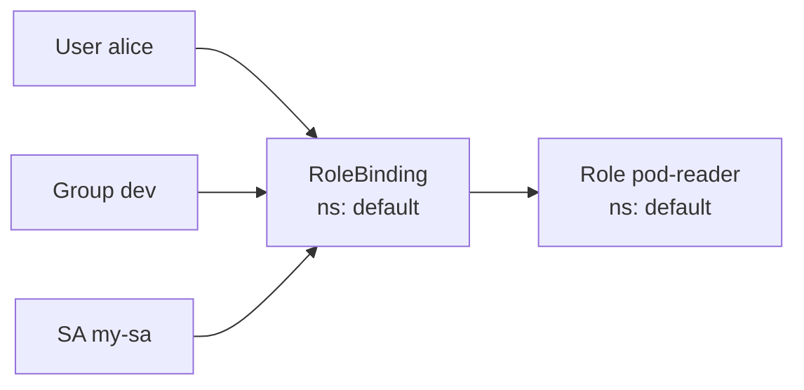

# 14 · RBAC: Users & Groups

---

## Why RBAC?

So far you've been the **cluster admin** — you can do anything. In real life, developers, QA, CI systems… also need access, but **not to everything** (least privilege: if they don't need it, don't give it).

**RBAC = Role-Based Access Control.** You define *what can be done* (a Role) and *who* gets it (a Binding).

## Roles vs ClusterRoles

A **Role** is a list of **rules**: which **resources** (pods, deployments, services, configmaps…) in which **API groups**, with which **verbs**.

| | Role | ClusterRole |
|---|---|---|
| Scope | **one namespace** (`metadata.namespace`) | **whole cluster** — all namespaces + cluster-scoped resources (nodes, PVs, namespaces) |

**Verbs**: `get`, `list`, `watch` (read) · `create`, `update`, `patch`, `delete`, `deletecollection` (write) · `*` (all).

## RoleBinding vs ClusterRoleBinding

A Role on its own does nothing. A **binding** connects a role to **subjects** (User, Group, ServiceAccount).



| Binding | References | Grants permissions in |
|---|---|---|
| **RoleBinding** | a Role (same ns) **or** a ClusterRole | **only its namespace** |
| **ClusterRoleBinding** | a ClusterRole | **all namespaces** |

(Binding a *ClusterRole* with a *RoleBinding* is a handy way to reuse a common role, like `view` or `edit`, in just one namespace.)

## Users & Groups

> **Kubernetes has no User objects.** There's no `kubectl create user`.

Users live **outside** the cluster; Kubernetes only **authenticates** them. Options: **X.509 client certificates** (used here), OIDC/SSO tokens, cloud IAM (on GKE: your Google account), webhook…

With certificates, the identity comes from the cert:
- **CN** (Common Name) → **username**
- **O** (Organization) → **group(s)**

Any certificate signed by the cluster's **CA** is trusted. Names starting with `system:` are reserved.

## Create a user certificate

```bash
# 1. private key
openssl genrsa -out alice.key 2048
# 2. Certificate Signing Request: CN=user, O=group
openssl req -new -key alice.key -out alice.csr -subj "/CN=alice/O=dev"
# 3. sign it with the cluster CA (Minikube keeps it in ~/.minikube)
openssl x509 -req -in alice.csr -CA ~/.minikube/ca.crt -CAkey ~/.minikube/ca.key \
  -CAcreateserial -out alice.crt -days 500
# 4. inspect
openssl x509 -in alice.crt -noout -text     # Subject: O = dev, CN = alice
```

> Modern alternative that doesn't need the CA key: submit a `CertificateSigningRequest` object and `kubectl certificate approve` it.

## Configure kubectl for the user

Do it inside an isolated Docker container (no access to the admin kubeconfig) to prove it really works:

```bash
kubectl config view | grep server      # API server URL
docker run --rm -ti -v $PWD:/test -w /test -v ~/.minikube/ca.crt:/ca.crt \
  -v $(which kubectl):/usr/bin/kubectl alpine sh
```
Inside (or just on your machine):
```bash
kubectl config set-cluster minikube --server=https://<API-IP>:8443 --certificate-authority=/ca.crt
kubectl config set-credentials alice --client-certificate=alice.crt --client-key=alice.key
kubectl config set-context alice --cluster=minikube --user=alice
kubectl config use-context alice
kubectl get pods
# Error from server (Forbidden): pods is forbidden: User "alice" cannot list resource "pods" … in the namespace "default"
```
Authenticated (K8s knows it's `alice`) but **not authorized** — new users can do **nothing** by default.

## Make sure RBAC is enabled

```bash
kubectl cluster-info dump | grep authorization-mode     # should include RBAC
kubectl api-versions | grep rbac                         # rbac.authorization.k8s.io/v1
# if missing (old Minikube):
minikube start --extra-config=apiserver.authorization-mode=RBAC
```
(RBAC is on by default in modern Minikube and in GKE.)

## Switch contexts

```bash
kubectl config get-contexts
kubectl config use-context minikube   # admin — apply roles as admin!
kubectl config use-context alice    # test as the user
kubectl auth whoami                   # recent kubectl versions
```
> Apply RBAC objects **as the admin** — `alice` can't grant themselves permissions.

Quick test without switching: `kubectl auth can-i list pods --as alice [-n default]`.

## Role: read pods in a namespace

```bash
kubectl api-resources | grep roles     # roles … rbac.authorization.k8s.io/v1  Role
```
```yaml
apiVersion: rbac.authorization.k8s.io/v1
kind: Role
metadata:
  namespace: default
  name: pod-reader
rules:
- apiGroups: [""]              # "" = core group (pods, services, configmaps, secrets…)
  resources: ["pods"]
  verbs: ["get", "watch", "list"]
```

## RoleBinding: give it to the user

```yaml
apiVersion: rbac.authorization.k8s.io/v1
kind: RoleBinding
metadata:
  name: read-pods
  namespace: default
subjects:
- kind: User
  name: alice                # case sensitive — must match the cert CN
  apiGroup: rbac.authorization.k8s.io
roleRef:
  kind: Role
  name: pod-reader
  apiGroup: rbac.authorization.k8s.io
```
```bash
kubectl apply -f alice-pods.yaml          # as admin
kubectl --context alice get pods          # works
kubectl --context alice get pods -n kube-system   # fails: Role only covers "default"
kubectl --context alice get svc           # fails: only pods
```

## More rules: list Deployments

Deployments are in the **`apps`** group (`kubectl api-resources | grep deployments`):
```yaml
- apiGroups: ["apps"]
  resources: ["deployments"]
  verbs: ["get", "watch", "list"]
```
(Rules are additive; pick a role name that reflects its content.)

## Verbs in practice — ConfigMaps

Role in namespace `dev` on `configmaps` with `get, watch, list, patch, delete` (no `create`/`update`):
```bash
kubectl --context alice get cm -n dev            # works
kubectl --context alice edit cm vars -n dev      # works (patch)
kubectl --context alice delete cm vars -n dev    # works
kubectl --context alice apply -f cm.yaml -n dev  # fails: create not allowed
kubectl --context alice get cm                   # fails: not in "default"
```
Verbs map to HTTP: `get/list/watch` → GET, `create` → POST, `update` → PUT, `patch` → PATCH, `delete` → DELETE.

## ClusterRole: pods in every namespace

No `namespace` in the metadata of either object:
```yaml
kind: ClusterRole
metadata:
  name: cluster-pod-reader
rules:
- apiGroups: [""]
  resources: ["pods"]
  verbs: ["get", "watch", "list"]
---
kind: ClusterRoleBinding
metadata:
  name: cluster-read-pods
subjects:
- kind: User
  name: alice
  apiGroup: rbac.authorization.k8s.io
roleRef:
  kind: ClusterRole
  name: cluster-pod-reader
  apiGroup: rbac.authorization.k8s.io
```
```bash
kubectl --context alice get pods -A     # works: every namespace
```

## Make a user cluster admin

Kubernetes ships with built-in ClusterRoles:
```bash
kubectl get clusterroles      # cluster-admin, admin, edit, view, system:* …
kubectl describe clusterrole cluster-admin    # resources: *.*, verbs: [*]
```
| Built-in ClusterRole | Gives |
|---|---|
| `cluster-admin` | everything, everywhere |
| `admin` | full control inside a namespace (incl. Roles), when bound with a RoleBinding |
| `edit` | read/write most objects (no Roles) |
| `view` | read-only (no Secrets) |

Bind `cluster-admin` to `alice` with a ClusterRoleBinding → they can do anything. Use sparingly!

## Roles for a Group

Create a second user `juan` with the **same group** `O=dev` (repeat the cert steps with `CN=juan/O=dev`). Then bind to the **Group**, not each user:

```yaml
kind: ClusterRole
metadata:
  name: svc-clusterrole
rules:
- apiGroups: [""]
  resources: ["services"]
  verbs: ["*"]
---
kind: ClusterRoleBinding
metadata:
  name: cluster-svc
subjects:
- kind: Group
  name: dev
  apiGroup: rbac.authorization.k8s.io
roleRef:
  kind: ClusterRole
  name: svc-clusterrole
  apiGroup: rbac.authorization.k8s.io
```
```bash
kubectl --context juan get svc -A       # works: juan is in group dev
kubectl --context alice get svc -A    # works: alice too
```
Groups make onboarding easy: issue a cert with the right `O=` and the permissions come with it.

---

## RBAC on GKE

On GKE you don't hand out certificates: users authenticate with their **Google identity** (`gcloud container clusters get-credentials`). Two layers apply:
- **IAM** (project level): e.g. `roles/container.viewer`, `roles/container.developer`, `roles/container.admin`.
- **Kubernetes RBAC** (in-cluster): bind `kind: User, name: someone@example.com` or `kind: Group, name: gke-security-groups@yourdomain.com` (Google Groups for RBAC).

```bash
kubectl create clusterrolebinding me-admin --clusterrole=cluster-admin --user=$(gcloud config get-value account)
```

---

## Cheat sheet

```bash
kubectl get roles,rolebindings -n <ns>
kubectl get clusterroles,clusterrolebindings
kubectl describe role <r> -n <ns>
kubectl auth can-i <verb> <resource> [--as user] [--as-group g] [-n ns]
kubectl auth can-i --list --as alice -n default
kubectl create role pod-reader --verb=get,list,watch --resource=pods -n default
kubectl create rolebinding read-pods --role=pod-reader --user=alice -n default
kubectl create clusterrolebinding x --clusterrole=view --group=dev
```
