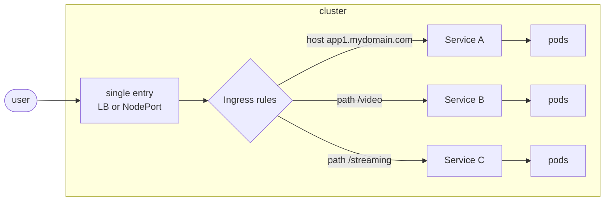

# 16 · Ingress — expose your apps outside the cluster

---

## How do we expose an app today?

Everything so far lived **inside** the cluster. To let real users in we had:
- **NodePort** – `<nodeIP>:30000-32767`. Ugly ports, need to know node IPs, one port per service.
- **LoadBalancer** – one **cloud load balancer per Service**.

## The problem / how Ingress helps

Your company grows: `mydomain.com` → app A, then app B, then app C… With `LoadBalancer` services that's **one paid LB + one public IP per service**, and no way to route by path or hostname. It doesn't scale (and costs money).

## How Ingress works

**One single entry point** into the cluster + **routing rules** (L7 / HTTP):


Rules can match on **host** (`app1.mydomain.com`), **path** (`/video`), or both. Plus TLS termination in one place.

## Ingress Controller

- An **Ingress** resource is **just the rules** (YAML). By itself it does nothing.
- An **Ingress Controller** is the software (usually a Deployment in the cluster) that **watches Ingress objects and actually routes traffic**. You must install one.
- Popular controllers: **ingress-nginx**, the **GKE Ingress controller** (Google Cloud HTTP(S) Load Balancer — built into GKE), AWS Load Balancer Controller, Traefik, HAProxy, Contour…
- The controller itself is exposed with a **NodePort** (Minikube/bare metal) or a **LoadBalancer** (cloud) — that's the single entry point.

> **New:** **Gateway API** (`Gateway` + `HTTPRoute`) is the newer, more expressive successor to Ingress; GKE supports it natively. Ingress remains widely used and is what these notes cover.

## Install the NGINX Ingress Controller

Instead of applying the controller YAML by hand (bare-metal style), on Minikube just do:
```bash
minikube addons enable ingress
kubectl get ns                                  # ingress-nginx
kubectl get pods -n ingress-nginx               # ingress-nginx-controller-… Running
```
Any other cluster (Helm):
```bash
helm upgrade --install ingress-nginx ingress-nginx \
  --repo https://kubernetes.github.io/ingress-nginx --namespace ingress-nginx --create-namespace
```

## Expose the controller with a NodePort

The controller needs a NodePort Service; the Minikube addon **already creates it**:
```bash
kubectl get svc -n ingress-nginx
# ingress-nginx-controller  NodePort  …  80:31654/TCP,443:32222/TCP   (random ports)
minikube service ingress-nginx-controller --url -n ingress-nginx
# http://127.0.0.1:41257   ← your entry point (keep the terminal open with the Docker driver)
```
Opening it now gives **nginx 404** — the controller works but there are no rules yet.

## A sample app

Deployment (3 × `nginx:alpine`) whose command writes `VERSION 1.0 desde $HOSTNAME` into `index.html`, plus a **ClusterIP** Service `app-v1` on port **8080 → 80**.
```bash
kubectl apply -f ingress-example.yaml
```
Note: the Service is only **ClusterIP** — the Ingress controller (inside the cluster) reaches it; users never hit it directly.

## Your first Ingress rules

**Warning:** Older tutorials use the removed `networking.k8s.io/v1beta1` API. Changes for `v1`:

| v1beta1 (old) | v1 (now) |
|---|---|
| `apiVersion: networking.k8s.io/v1beta1` | `apiVersion: networking.k8s.io/v1` |
| — | `pathType: Prefix` (or `Exact` / `ImplementationSpecific`) **required** |
| `serviceName: app-v1` | `service.name: app-v1` |
| `servicePort: 8080` | `service.port.number: 8080` |
| annotation `kubernetes.io/ingress.class` | `spec.ingressClassName: nginx` |

Path rule:
```yaml
apiVersion: networking.k8s.io/v1
kind: Ingress
metadata:
  name: ingress-test
  annotations:
    nginx.ingress.kubernetes.io/rewrite-target: /   # strip /appv1 before forwarding
spec:
  ingressClassName: nginx
  rules:
  - http:
      paths:
      - path: /appv1
        pathType: Prefix
        backend:
          service:
            name: app-v1
            port:
              number: 8080
```
```bash
kubectl apply -f ingress.yaml
kubectl get ingress            # or: kubectl get ing
kubectl describe ing ingress-test
curl $URL/appv1                # VERSION 1.0 desde ingress-depl-xxxx  (refresh → hostname changes = load balancing)
```

## Rules by host and by path

Fake domains for testing: the old `/etc/hosts` trick doesn't work with Minikube on Docker (the node has its own IP). Use curl's `Host` header instead:
```bash
curl -H "Host: app1.mydomain.com" $URL
curl $URL/test                  # rule without host = any host
```

## Second app, distribute traffic

Deployment `api-deplo` ("Soy app numero 2 desde $HOSTNAME") + ClusterIP Service `api-server-svc` on **9090 → 80**.
```bash
kubectl apply -f app-ingress2.yaml
kubectl apply -f ingress-rules.yaml
curl -H "Host: app1.mydomain.com" $URL     # VERSION 1.0 …
curl -H "Host: app2.mydomain.com" $URL     # Soy app numero 2 …
```
**One entry point, two apps** — no extra load balancers.

## Combine host + path

```
entrada1.mydomain.com/app1       → app-v1
entrada1.mydomain.com/app2       → api-server-svc
entrada2.mydomain.com/servicio1  → app-v1
entrada2.mydomain.com/servicio2  → api-server-svc
```
```bash
kubectl apply -f ingress-host.yaml
curl -H "Host: entrada2.mydomain.com" $URL/servicio2
```

### TLS (bonus)
```yaml
spec:
  tls:
  - hosts: [app1.mydomain.com]
    secretName: app1-tls          # kubectl create secret tls app1-tls --cert=… --key=…
```
(cert-manager can issue Let's Encrypt certs automatically.)

---

## Cheat sheet

```bash
minikube addons enable ingress
kubectl get ingressclass
kubectl get ing [-A] | kubectl describe ing <name>
kubectl edit ing <name>
kubectl logs -n ingress-nginx deploy/ingress-nginx-controller
minikube service ingress-nginx-controller --url -n ingress-nginx
curl -H "Host: <fake-host>" <url>/<path>
```

On GKE the controller is built in — see [18-gke-ingress](../18-gke-ingress/README.md).
