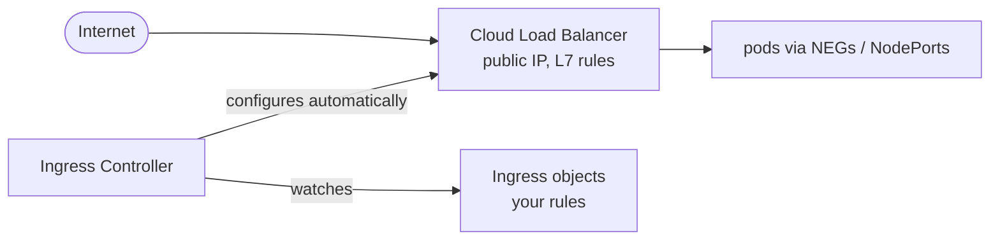

# 18 · GKE: Ingress & Load Balancers

---

## Ingress in the cloud

On Minikube the Ingress controller (nginx) was exposed through a **NodePort**. In the cloud, the single entry point is a real **cloud load balancer** with a public IP:



| | AWS EKS | GKE (here) |
|---|---|---|
| Controller | **AWS Load Balancer Controller** — you install it | **GKE Ingress controller** — **built in** (HttpLoadBalancing add-on, on by default) |
| LB created | Application Load Balancer (ALB) | Google Cloud **external Application Load Balancer** |
| Prereqs | OIDC provider, IAM policy, IAM role + SA, cert-manager, controller YAML, IngressClass | none |
| Ingress class | `alb` | `gce` (external) / `gce-internal` (internal) |
| Pods targeted via | target type `ip` | **NEGs** (container-native load balancing) |

## Requirements

On EKS you need AWS IAM prerequisites (associate an OIDC provider, create an IAM policy, create an IAM role bound to a Kubernetes ServiceAccount — IRSA). **On GKE none of this is needed** for Ingress: the controller runs in Google's control plane with its own permissions.

Just check the add-on is enabled (it is by default):
```bash
gcloud container clusters describe test-cluster --zone us-central1-a \
  --format="value(addonsConfig.httpLoadBalancing)"     # empty or disabled: false = enabled
```
(The GKE equivalent of IRSA, for *your own* pods calling Google APIs, is **Workload Identity Federation** — see [15-rbac-serviceaccounts](../15-rbac-serviceaccounts/README.md).)

## Deploy the controller

Nothing to deploy on GKE.

Prefer nginx? You can still install **ingress-nginx** on GKE; its Service becomes `type: LoadBalancer` (an L4 passthrough Network LB) and you use `ingressClassName: nginx` exactly like in [16-ingress](../16-ingress/README.md).

## Deploy a test app — [`game-2048.yaml`](game-2048.yaml)

Namespace `game-2048` + Deployment (3 replicas of the 2048 game) + ClusterIP Service:
```bash
kubectl apply -f game-2048.yaml
kubectl get pods -n game-2048
kubectl port-forward -n game-2048 deploy/deployment-2048 7000:80    # check it without Ingress → http://localhost:7000
```

Service notes for GKE Ingress:
- **Container-native load balancing (NEGs)**: the LB sends traffic **directly to pod IPs** (like AWS `target-type: ip`). It's the default on VPC-native clusters (the default cluster type); the `cloud.google.com/neg: '{"ingress": true}'` annotation makes it explicit.
- Without NEGs the backend Service must be `type: NodePort`.
- The LB **health check** uses the pod's `readinessProbe` path if defined, else `GET /` must return 200.

## Add the Ingress resource

Same file:
```yaml
apiVersion: networking.k8s.io/v1
kind: Ingress
metadata:
  namespace: game-2048
  name: ingress-2048
  annotations:
    kubernetes.io/ingress.class: "gce"     # public; "gce-internal" for a private LB
spec:
  defaultBackend:
    service:
      name: service-2048
      port:
        number: 80
```
```bash
kubectl get ingress -n game-2048 -w        # ADDRESS appears after ~5–10 min (LB provisioning)
kubectl describe ingress ingress-2048 -n game-2048   # events + backend health
curl http://<ADDRESS>                       # or open it in the browser → 2048
```
In the console: **Network services → Load balancing** shows the LB the controller created (forwarding rule, URL map, backend service, health check).

Static IP + DNS + HTTPS (production):
```bash
gcloud compute addresses create web-ip --global
# Ingress annotation:  kubernetes.io/ingress.global-static-ip-name: web-ip
# Google-managed cert: create a ManagedCertificate object and annotate
#   networking.gke.io/managed-certificates: <name>
```

## Modify the Ingress rules — [`ingress-rules.yaml`](ingress-rules.yaml)

```bash
kubectl edit ingress ingress-2048 -n game-2048      # or apply the file
kubectl apply -f ingress-rules.yaml
```
The controller updates the **URL map** of the existing load balancer (watch it change in the console). Differences vs nginx:
- No `rewrite-target`: `/game` is forwarded as `/game` to the pod.
- `pathType: Prefix`/`Exact` work on GKE ≥ 1.21.3; older clusters only support `ImplementationSpecific` (`/game/*` wildcard syntax).
- Changes take a minute or two to propagate.

> **New:** For new projects consider the **Gateway API** on GKE (`gatewayClassName: gke-l7-global-external-managed` + `HTTPRoute`): role separation, header matching, traffic splitting, cross-namespace routing.

## Delete the resources

```bash
kubectl delete -f game-2048.yaml
gcloud compute forwarding-rules list       # make sure the LB is gone (deleting the Ingress removes it)
```
**Warning:** Always delete Ingress / `LoadBalancer` Services **before** deleting the cluster, otherwise orphaned load balancers keep billing.

---

## Cheat sheet

```bash
kubectl get ing -A | kubectl describe ing <n> -n <ns>
kubectl get svc -n <ns> -o yaml | grep neg                    # NEG status annotation
gcloud compute backend-services list
gcloud compute network-endpoint-groups list
gcloud compute url-maps list
gcloud compute forwarding-rules list
```
