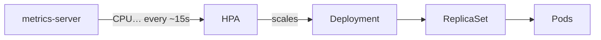

# 19 · GKE: Horizontal Pod Autoscaler (HPA)

HPA is a plain **Kubernetes** feature, so it works the same on any cluster; only the metrics-server step differs per platform.

---

## What is HPA?

A **HorizontalPodAutoscaler** is one more level in the hierarchy:


- "Horizontal" = more/fewer **pods** (vertical would be bigger/smaller pods → VPA).
- You set **min**, **max** and a **target** (e.g. 50 % average CPU). The HPA computes:
  `desiredReplicas = ceil(currentReplicas × currentUsage / target)`
- CPU % is relative to the container's **CPU request** → pods **must have requests**.
- These notes scale on **CPU** (memory scaling exists in `autoscaling/v2` but is less reliable; when RAM runs out pods get OOMKilled anyway, and CPU is usually what saturates first under load).

## Install a metrics server

On EKS you install metrics-server yourself. **On GKE it's preinstalled** (and on Minikube: `minikube addons enable metrics-server`).

```bash
kubectl get deployment -n kube-system | grep metrics-server
kubectl top nodes
kubectl top pods -A
```
No errors = metrics API available.

## Create an HPA — [`hpa.yaml`](hpa.yaml)

Note: `kubectl run` no longer creates Deployments, so use:
```bash
kubectl create deployment httpd --image=httpd
kubectl set resources deployment httpd -c=httpd --requests=cpu=500m --limits=cpu=500m
kubectl expose deployment httpd --port=80
kubectl autoscale deployment httpd --cpu-percent=50 --min=1 --max=10
```
or declaratively:
```bash
kubectl apply -f hpa.yaml
kubectl get hpa                 # TARGETS: 0%/50%   MINPODS 1   MAXPODS 10   REPLICAS 1
kubectl describe hpa httpd
```
> `<unknown>/50%` in TARGETS = no metrics yet (wait a minute) or the pods have **no CPU request**.

## HPA in action

Generate load from inside the cluster (a load generator hitting the Service):
```bash
kubectl run -it --rm load-generator --image=busybox:1.36 --restart=Never -- \
  /bin/sh -c "while true; do wget -q -O- http://httpd; done"
# or Apache Bench:
kubectl run -it --rm ab --image=httpd --restart=Never -- ab -n 500000 -c 100 http://httpd/
```
In another terminal:
```bash
kubectl get hpa httpd -w        # CPU climbs over 50% → REPLICAS grows
kubectl get pods -w
kubectl top pods
```
Stop the load → after the **scale-down stabilization window (5 min default)** replicas drop back to `minReplicas`.

Edit live (e.g. `minReplicas: 3`):
```bash
kubectl edit hpa httpd
```

## What if there are no nodes left for the new pods?

The math: node = `e2-medium` ≈ 2 vCPU (≈ 1.9 allocatable after system pods); each pod requests **0.5 CPU** → only ~3 pods fit per node.

When the HPA asks for more:
```bash
kubectl get pods            # extra pods: Pending
kubectl describe pod <p>    # FailedScheduling: 0/1 nodes are available: Insufficient cpu
```
The HPA scales **pods**, not **machines**. Something must add nodes → **Cluster Autoscaler** ([next](../20-gke-cluster-autoscaler/README.md)).

> On **GKE Autopilot** this never happens: nodes are provisioned automatically for any pending pod.

---

## Cheat sheet

```bash
kubectl autoscale deployment <d> --cpu-percent=50 --min=1 --max=10
kubectl get hpa [-w] | kubectl describe hpa <h> | kubectl edit hpa <h>
kubectl top pods | kubectl top nodes
kubectl delete hpa <h>
```
