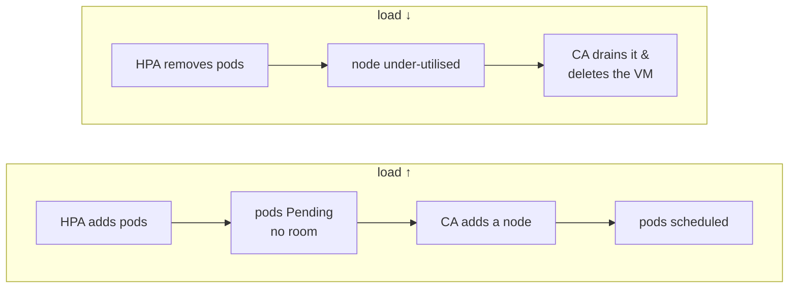

# 20 · GKE: Cluster Autoscaler

---

## What is the Cluster Autoscaler?

| Autoscaler | Scales | Trigger |
|---|---|---|
| **HPA** ([19](../19-gke-hpa/README.md)) | number of **pods** | CPU/metrics above/below target |
| **Cluster Autoscaler (CA)** | number of **nodes** | **Pending** pods that don't fit (scale up) / under-used nodes (scale down) |


The CA reacts to **requests**, not real usage — another reason to set good requests.

## Requirements

On EKS the CA is an open-source Deployment you install yourself, with IAM permissions and Auto Scaling Group tags (`k8s.io/cluster-autoscaler/enabled`, `k8s.io/cluster-autoscaler/<cluster>`) — that's why the node group was created with `--asg-access`.

**On GKE the Cluster Autoscaler is built in and managed by Google.** You only enable it per node pool with min/max. We already did that when creating the pool in [17-gke-cluster](../17-gke-cluster/README.md):
```bash
--enable-autoscaling --min-nodes 1 --max-nodes 3
```

## Deploy / enable it

Nothing to deploy. To enable or change it on an existing pool:
```bash
gcloud container clusters update test-cluster --zone us-central1-a \
  --node-pool test-workers \
  --enable-autoscaling --min-nodes 1 --max-nodes 3

# optional: scale down more aggressively (the open-source CA uses --skip-nodes-with-system-pods=false etc.)
gcloud container clusters update test-cluster --zone us-central1-a \
  --autoscaling-profile optimize-utilization       # default: balanced
```
Open-source CA flags ↔ GKE:

| EKS CA flag | GKE |
|---|---|
| `--node-group-auto-discovery=asg:tag=…` | not needed — per-pool `--enable-autoscaling` |
| `--balance-similar-node-groups` | automatic across zones of a pool (`--location-policy BALANCED`) |
| `--skip-nodes-with-system-pods=false` | handled by GKE; `optimize-utilization` profile for faster scale-down |

Bonus — **node auto-provisioning** (GKE creates whole new node pools with the right machine shape):
```bash
gcloud container clusters update test-cluster --zone us-central1-a \
  --enable-autoprovisioning --max-cpu 16 --max-memory 64
```

## See it scale up

Delete the HPA (so it doesn't fight you) and scale the Deployment directly — faster than waiting for load.
```bash
kubectl delete hpa httpd
kubectl get nodes                          # 1 node
kubectl scale deployment httpd --replicas=7   # 7 × 0.5 CPU ≈ 3.5 CPU → needs ~2–3 e2-medium nodes
kubectl get pods -w                        # some Pending…
kubectl describe pod <pending-pod>         # Events: TriggeredScaleUp … pod triggered scale-up
kubectl get nodes -w                       # new gke-…-test-workers-… nodes join (~1–2 min)
```
Logs/visibility:
```bash
kubectl get events -A --field-selector reason=TriggeredScaleUp
# Console: Kubernetes Engine → cluster → Logs, or Cloud Logging query:
#   resource.type="k8s_cluster" logName:"cluster-autoscaler-visibility"
```
If you hit `--max-nodes`, the remaining pods just stay Pending (`max node group size reached`).

## See it scale down

```bash
kubectl scale deployment httpd --replicas=1
kubectl get nodes -w
```
After ~10 minutes of a node being under-utilised (its pods fit elsewhere), the CA **cordons, drains and deletes** it, down to `--min-nodes`. Things that can block scale-down: pods with local storage, bare pods without a controller, restrictive PodDisruptionBudgets, `cluster-autoscaler.kubernetes.io/safe-to-evict: "false"`.

> The full picture: **HPA** (pods) + **Cluster Autoscaler** (nodes) = an app that grows and shrinks with traffic and a bill that follows it. **GKE Autopilot** gives you both without configuring anything.

---

## Cheat sheet

```bash
gcloud container clusters update <c> --node-pool <p> --enable-autoscaling --min-nodes N --max-nodes M --zone …
gcloud container clusters update <c> --no-enable-autoscaling --node-pool <p> --zone …
gcloud container node-pools describe <p> --cluster <c> --zone … --format="yaml(autoscaling)"
kubectl get events -A | grep -i scale
```
