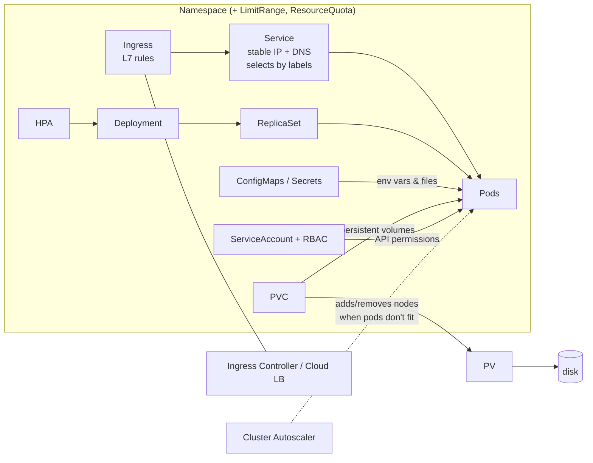

# Kubernetes study notes

Notes covering Kubernetes from the basics (pods, controllers, networking, config, storage, RBAC) to running real clusters on **Google Kubernetes Engine (GKE)**.
Each folder has a `README.md` with explanations and a cheat sheet; some include runnable manifests.

## Index

| # | Folder |
|---|---|
| 00 | [Intro, architecture & Minikube](00-intro-architecture/README.md) |
| 01 | [Pods](01-pods/README.md) |
| 02 | [ReplicaSets](02-replicasets/README.md) |
| 03 | [Deployments: rollouts & rollbacks](03-deployments/README.md) |
| 04 | [Services & Endpoints](04-services/README.md) |
| 05 | [Hands-on: Go backend + JS frontend](05-hands-on-app/README.md) |
| 06 | [Namespaces & Context](06-namespaces/README.md) |
| 07 | [Limits & requests (RAM/CPU), QoS](07-limits-requests/README.md) |
| 08 | [LimitRange](08-limitrange/README.md) |
| 09 | [ResourceQuota](09-resourcequota/README.md) |
| 10 | [Health checks & Probes](10-probes/README.md) |
| 11 | [ConfigMaps & env vars](11-configmaps-env/README.md) |
| 12 | [Secrets](12-secrets/README.md) |
| 13 | [Volumes: emptyDir, hostPath, PV, PVC, StorageClass](13-volumes/README.md) |
| 14 | [RBAC: Users & Groups](14-rbac-users-groups/README.md) |
| 15 | [RBAC: ServiceAccounts](15-rbac-serviceaccounts/README.md) |
| 16 | [Ingress (nginx)](16-ingress/README.md) |
| 17 | [GKE: setup & cluster](17-gke-cluster/README.md) |
| 18 | [GKE: Ingress & Load Balancers](18-gke-ingress/README.md) |
| 19 | [GKE: Horizontal Pod Autoscaler](19-gke-hpa/README.md) |
| 20 | [GKE: Cluster Autoscaler](20-gke-cluster-autoscaler/README.md) |
| 21 | [GKE: cleanup](21-gke-cleanup/README.md) |

## The big picture



Each level solves a problem of the level below it:
1. **Pod** – runs containers, but doesn't heal itself, can't replicate, can't be updated in place.
2. **ReplicaSet** – keeps *N* pods alive, but can't roll out a new pod template.
3. **Deployment** – rolling updates and rollbacks via ReplicaSets.
4. **Service** – one stable address in front of changing pods.
5. **Ingress** – one entry point for many services from outside.

## Things that changed in recent Kubernetes versions

| Old | Now |
|---|---|
| `kubectl run --generator=run-pod/v1` | `kubectl run name --image=…` (flag removed; `run` only creates pods) |
| `kubectl apply --record` | `kubernetes.io/change-cause` annotation |
| Ingress `networking.k8s.io/v1beta1`, `serviceName/servicePort` | `networking.k8s.io/v1`, `pathType`, `service.name/port.number` |
| Manual nginx ingress controller YAML | `minikube addons enable ingress` |
| ServiceAccount token Secrets auto-created | K8s ≥ 1.24: projected short-lived tokens, `kubectl create token` |
| `k8s.gcr.io` images | `registry.k8s.io` |
| PV reclaim policy `Recycle` | deprecated — use dynamic provisioning |
| Docker as runtime | containerd (images built with Docker still work) |

## Local setup

```bash
brew install kubectl minikube
minikube start
kubectl get nodes
kubectl api-resources   # kinds, shortnames, apiVersion
```
